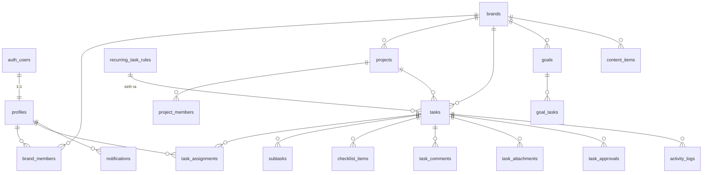

# 3. Cơ sở dữ liệu (PostgreSQL nhúng)

Mã nguồn: `server/migrations/` (áp dụng tự động theo thứ tự tên file khi máy chủ khởi động; vai trò và bảng tài khoản ở `server/bootstrap.sql`). CSDL là PostgreSQL chạy nhúng trong tiến trình Node (PGlite), lưu ở `DATA_DIR/db`.

## Sơ đồ quan hệ

## Bảng

| Bảng | Mục đích | Ghi chú quan trọng |
|---|---|---|
| `profiles` | Hồ sơ người dùng (Users + Employee profiles) | `role` admin/employee, `is_active`, `is_demo`; tạo tự động khi đăng ký |
| `invitations` | Lời mời nhân viên | Đăng ký đúng email → kích hoạt với vai trò, thương hiệu đã chọn |
| `brands` | 4 thương hiệu (dữ liệu thật, tạo sẵn) | `color` theo bảng màu |
| `brand_members` | Nhân viên thuộc thương hiệu nào | Nhiều-nhiều |
| `projects`, `project_members` | Dự án / chiến dịch | Ngày bắt đầu ≤ hạn; `links` jsonb |
| `tasks` | Công việc | Xem cột thời gian bên dưới; `weight` ∈ {1,2,3,5}; `progress` 0–100 |
| `task_assignments` | Giao việc (nhiều người) | Thêm/bỏ qua RPC `set_task_assignees` |
| `subtasks`, `checklist_items` | Việc con, bước nhỏ | Nhân viên chỉ được tích hoàn thành |
| `task_comments` | Trao đổi, ghi chú tiến độ, vướng mắc | `mentions` uuid[] → thông báo |
| `task_attachments` | Tệp (lưu trên đĩa `DATA_DIR/files`, quyền do RLS của `storage.objects` quyết định) | Đường dẫn bắt buộc `<task_id>/…` |
| `task_approvals` | Mỗi lần nộp duyệt 1 bản ghi | Quyết định, người duyệt, thời điểm, điểm 1–5, phản hồi |
| `activity_logs` | Nhật ký thay đổi | Chỉ trigger ghi; không ai sửa/xóa qua API |
| `recurring_task_rules` | Quy tắc việc lặp lại (GĐ 2): `frequency` daily/weekly/monthly, `weekdays` 1=T2…7=CN, `day_of_month`, `due_time`, `assignee_ids`, `last_generated_on` | `unique(recurring_rule_id, recurrence_key)` trên `tasks` chống tạo trùng; dự án phải cùng thương hiệu |
| `goals`, `goal_members`, `goal_tasks`, `goal_progress_logs` | Mục tiêu & KPI (GĐ 3). `metric`: `thu_cong` (nhập tay), `so_viec` / `trong_so` (tự tính từ việc liên kết) | `goal_type` tách "công việc" và "kết quả kinh doanh" (kết quả kinh doanh luôn nhập tay); việc liên kết phải cùng thương hiệu; lịch sử chỉ ghi qua `record_goal_progress` |
| `content_items` | Lịch nội dung (GĐ 3): kênh, chủ đề, ngày đăng, kịch bản/quay/dựng (`chua_bat_dau`/`dang_lam`/`xong`/`khong_can`), duyệt, `published_at`, lượt xem/tương tác/khách | Có `task_id` để liên kết, tránh cập nhật 2 lần; người phụ trách chỉ sửa được cột sản xuất/số liệu |
| `notifications` | Thông báo trong ứng dụng; `dedupe_key` (GĐ 2) để nhắc hạn / quá hạn chỉ gửi 1 lần | Người dùng chỉ được đổi `is_read` |
| `app_settings` | Trọng số KPI, nhắc hạn | Mặc định không gộp điểm |

## Các mốc thời gian của công việc (phục vụ đánh giá công bằng)

| Cột | Ý nghĩa |
|---|---|
| `due_at` | Hạn chót hiện hành (23:59 giờ VN của ngày chọn) |
| `original_due_at` | Hạn gốc lúc tạo — so sánh để biết quản lý đã dời hạn |
| `first_submitted_at` / `submitted_at` | Lần nộp đầu / gần nhất của nhân viên |
| `approved_at`, `approved_by` | Thời điểm và người duyệt |
| `completed_at` | Thời điểm hoàn thành **tính cho nhân viên** = thời điểm nộp của lần được duyệt |

## Trigger và hàm

| Tên | Việc làm |
|---|---|
| `handle_new_user` | Tạo `profiles` khi có tài khoản; kích hoạt nếu có lời mời |
| `invitations_after_insert` | Mời email đã có tài khoản → kích hoạt ngay |
| `profiles_guard` | Chặn nhân viên đổi vai trò/chức danh/trạng thái; chặn quản trị viên tự gỡ quyền |
| `tasks_before_update` | Chặn nhân viên sửa cột ngoài trạng thái/tiến độ/vướng mắc/bằng chứng; giới hạn chuyển trạng thái |
| `tasks_after_change`, `task_assignments_after_change`, `task_comments_after_insert`, `task_attachments_after_change` | Ghi nhật ký + thông báo |
| `submit_task(task, evidence)` | Nhân viên nộp duyệt (hoặc hoàn thành nếu không cần duyệt) |
| `review_task(task, approve, quality, feedback)` | Quản trị viên duyệt / yêu cầu sửa |
| `set_task_assignees(task, users[])` | Đặt lại danh sách người được giao |
| `purge_demo_data()` | Quản trị viên (tài khoản thật) xóa dữ liệu mẫu |
| `bootstrap_admin(email)` | Chỉ chạy trong SQL Editor: đặt quản trị viên đầu tiên |
| `seed_demo_data(...)`, `purge_demo_data_service()` | Chỉ service_role (script `npm run demo:*`) |

## Chỉ mục

Có chỉ mục cho các khóa ngoại và cột lọc thường dùng: `tasks(brand_id, project_id, status, due_at, primary_owner_id, completed_at)`, `task_assignments(user_id)`, `activity_logs(task_id, created_at)`, `notifications(user_id, is_read, created_at)`…

## Kiểm thử

`npm run db:test` mở CSDL nhúng trong bộ nhớ, áp dụng toàn bộ migration và chạy `server/tests/10_rls_workflow_test.sql` (hơn 25 kiểm tra quyền và quy trình) cùng các kiểm tra đăng ký theo lời mời và truy vấn dưới RLS (`server/db.test.ts`).

## Hàm định kỳ (Giai đoạn 2 — `20261016000005_phase2.sql`)

| Hàm | Việc làm |
|---|---|
| `generate_recurring_tasks(p_days = 7)` | Sinh việc từ các quy tắc đang bật cho hôm nay → +7 ngày (giờ VN), giao người, không tạo trùng |
| `send_due_reminders()` | Nhắc "sắp đến hạn" (theo `app_settings.reminders.days_before_due`) và "quá hạn" (người làm + quản trị); không tính việc chờ duyệt / tạm dừng |
| `run_scheduled_jobs()` | Gọi cả hai, trả về `{generated, reminders}`. Máy chủ gọi mỗi giờ; ứng dụng cũng gọi 1 lần mỗi phiên |

## Giai đoạn 3 — `20261017000006_phase3.sql`

| Đối tượng | Việc làm |
|---|---|
| `notifications.link`, `notifications.emailed_at` | Đường dẫn trong ứng dụng cho thông báo không gắn công việc; đánh dấu đã gửi email |
| `profiles.email_notifications` | Người dùng tự bật/tắt email |
| `record_goal_progress(goal, value, note)` | Quản trị viên hoặc người phụ trách mục tiêu ghi kết quả thực tế + lịch sử; báo quản trị viên |
| `content_items_guard` / `content_items_notify` | Chặn nhân viên sửa cột ngoài phạm vi, chỉ được gửi duyệt; thông báo khi giao / chờ duyệt / duyệt / yêu cầu sửa |
| `email_queue(limit)` | Chỉ service_role: thông báo chưa gửi email trong 2 ngày gần nhất của người đang bật email |
| `seed_demo_phase3(employees)` | Mục tiêu và lịch nội dung mẫu (có nhãn Mẫu, xóa cùng dữ liệu mẫu) |
